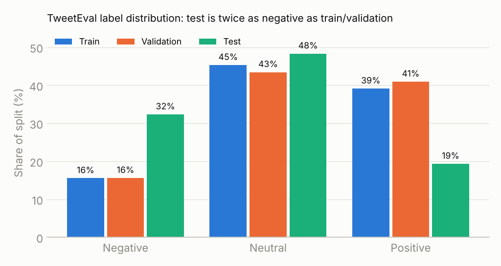
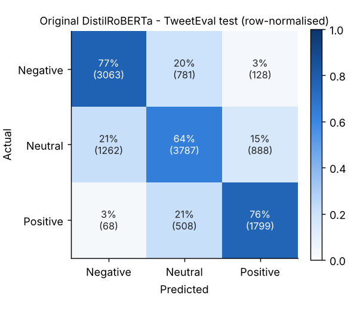

# Election Sentiment Analyzer: tweet sentiment with transformers

Three-class sentiment classification (negative / neutral / positive) of tweets and short political
statements, with a reproducible training and evaluation pipeline, a pre-registered election-domain
benchmark and a Streamlit app that shows class probabilities and uncertainty.

> **Status (2026-11-08).** The Kaggle experiment suite completed its evaluation. The selected fine-tuned Cardiff Twitter-RoBERTa achieved **71.96% accuracy / 72.03% macro-F1** on the TweetEval test set (12,284 tweets), compared with **70.48% / 70.52%** for the original checkpoint in the same evaluation run. The improvement was **+1.51 macro-F1 percentage points** (paired bootstrap 95% CI: +0.81 to +2.21 points). On 9,222 deduplicated GOP debate tweets, the selected model scored **60.91% accuracy / 59.09% macro-F1**. These are research results, **not the performance of the live app**: the fine-tuned Cardiff checkpoint was not preserved in the exported archive. The app uses the separately published DistilRoBERTa checkpoint. The Streamlit deployment has not yet been verified.

[Live Streamlit demo](https://sentiment-analysis-nlp-47ba2rhjyjfrrxbrog3nhc.streamlit.app/) — serves the published DistilRoBERTa model; the stronger Cardiff model is reported as an offline experiment, not deployed.

## Contents
[Problem](#problem) · [Data](#data) · [Results](#verified-results) · [Error analysis](#error-analysis) ·
[Method](#training-and-selection-methodology) · [Reproduce](#reproduce) · [App](#streamlit-app) ·
[Limitations](#limitations) · [Structure](#repository-structure) · [Attribution](#attribution)

## Problem
Given a short English text, predict the author's **overall expressed sentiment**. This is *not*
stance: "Thank you @tedcruz for calling out the RINOs" is positive in sentiment while attacking
other politicians. The project is presented as an *election* analyzer, but the model is trained on
general tweets. Measuring that domain gap honestly is part of the work (see
[docs/ELECTION_BENCHMARK.md](docs/ELECTION_BENCHMARK.md)).

## Data
| Dataset | Role | Size | Notes |
|---|---|---:|---|
| [TweetEval sentiment](https://github.com/cardiffnlp/tweeteval) (SemEval-2017 4A) | train / validation / test | 45,615 / 2,000 / 12,284 | Official files; sizes verified. Official metric is macro-recall. |
| CrowdFlower *First GOP Debate* tweets (Aug 2015) | election-domain **evaluation only** | 9,222 de-duplicated (3,589 high-agreement) | Real election tweets with crowd labels; agreement threshold fixed in advance. |

**Leakage and duplicates** ([docs/DATA_AUDIT.md](docs/DATA_AUDIT.md)): 0 exact or normalised overlaps
between train/validation and test. 10 near-duplicates (0.5%) link train and validation, and 23
near-duplicate groups inside train carry conflicting labels, which is direct evidence of label noise.

**Distribution shift (verified).** The test split is not drawn from the train/validation distribution:



Label shift train vs test: χ² = 2,531, Cramér's V = 0.148. Test tweets are also shorter (14.9 vs 19.2 words)
and twice as likely to contain hashtags. Validation scores therefore over-estimate test scores for
every model.

## Verified results

### TweetEval
| Model | Selected on | Val acc | Val macro-F1 | **Test acc** | **Test macro-F1** | Test macro-recall |
|---|---|---:|---:|---:|---:|---:|
| TF-IDF + LinearSVC (author's retrain, untuned) | – | – | – | 57.38 | – | – |
| **TF-IDF word+char + LinearSVC (B1, this repo)** | validation, 32 configs | 70.45 | 67.97 | **63.16** [62.25, 64.03] | **62.62** [61.68, 63.54] | 63.28 |
| **DistilRoBERTa, deployed model** | validation | 72.60\* | 70.85\* | **70.41** | **70.44** | 72.22 |
| Selected Cardiff Twitter-RoBERTa (research only; weights not preserved) | validation (2,000 tweets) | 77.05 | 75.71 | **71.96** | **72.03** | 73.64 |

Brackets are 95% bootstrap CIs. \*Measured on a random half of validation (1,000 tweets).
Deployed-model test metrics are re-derived from the recorded confusion matrix in `tests/test_metrics.py`.

### Election domain (GOP debate, transfer only)
| Model | GOP-full acc | GOP-full macro-F1 | GOP-high-agreement acc | GOP-high-agreement macro-F1 |
|---|---:|---:|---:|---:|
| B1 TF-IDF baseline | 55.35 [54.37, 56.40] | 50.49 [49.44, 51.57] | 64.34 [62.72, 65.84] | 55.32 [53.42, 57.11] |
| Original DistilRoBERTa (evaluated alongside selected model) | 59.62 | 57.07 | See archived evaluation | See archived evaluation |
| Selected Cardiff Twitter-RoBERTa (research only) | **60.91** | **59.09** | See archived evaluation | See archived evaluation |
| Selected transformer | ⏳ | ⏳ | ⏳ | ⏳ |

Even for the baseline, general-tweet performance does **not** carry over to election tweets
(about 12 macro-F1 points lower than on the TweetEval test set).

### Why not 100%?
TweetEval labels come from crowd annotators who often disagree. Conflicting labels on near-identical
tweets already appear in the training set, and published state-of-the-art systems reach roughly
72–74% macro-recall on this test set. Accuracy far above that would more likely signal leakage than
progress. The pipeline is built to report the best *defensible* number with its uncertainty.

## Error analysis
Original model, TweetEval test (3,635 errors):



| Actual → predicted | Count | Share of errors |
|---|---:|---:|
| neutral → negative | 1,262 | 34.7% |
| neutral → positive | 888 | 24.4% |
| negative → neutral | 781 | 21.5% |
| positive → neutral | 508 | 14.0% |
| negative ↔ positive | 196 | 5.4% |

95% of errors involve *neutral*; polarity flips (negative ↔ positive) are rare. Typical neutral → negative
cases are factual reports of negative events ("Survey shows Poroshenko has lost considerable electoral
support", "Major blaze breaks out near #Jerusalem"). There, negative *topic* words are read as negative
*sentiment*. Many such tweets are genuinely ambiguous: annotators could reasonably call some of them negative.

For the final model, the notebook generates automatically:
* confusion matrices with the original model beside it (paired bootstrap);
* heuristic slices: negation, sarcasm markers, political terms, news-like, mixed lexicon, questions,
  short and hashtag-heavy tweets;
* calibration (ECE, reliability diagram, temperature scaling fitted on validation);
* the 50 most confident errors per dataset, for manual review of possible label noise;
* learning curves and per-candidate accuracy on the GOP set.

## Training and selection methodology
* **Splits**: train → fit; validation → early stopping, hyper-parameters, model and ensemble selection.
  Test labels are loaded only by `sentiment.final_eval`, after selection is frozen to `selection.json`.
  A lock file refuses a second test evaluation of a different selection.
* **Staged search** ([docs/EXPERIMENTS.md](docs/EXPERIMENTS.md)):
  1. reproduce the original recipe;
  2. screen 6 architectures (DistilRoBERTa, RoBERTa-base, Twitter-RoBERTa-2022, BERTweet, DeBERTa-v3, Twitter-RoBERTa-sentiment);
  3. LR / class-weight sweep on the top 2;
  4. large models;
  5. seed repeats;
  6. probability-averaging ensembles.

  Stages 3–6 are generated from earlier *validation* results.
* **Selection rule (pre-declared)**: highest validation macro-F1. A larger ensemble is accepted only if it
  gains ≥ 0.5 points and the paired-bootstrap 95% CI excludes 0.
* **Tracking**: every run writes `result.json` (config, versions, GPU, duration, peak memory, epochs,
  log history, validation metrics, ECE) and validation probabilities. Tables are generated from these
  records, never typed by hand.

## Reproduce
```bash
pip install -r requirements-dev.txt
pip install -e .
python scripts/audit_data.py          # downloads TweetEval + checks duplicates/leakage/shift
python scripts/train_baseline.py      # classical baseline B1 (CPU, ~10 min)
pytest                                # 65 unit + integration tests (CPU, ~45 s)
python scripts/build_colab_notebook.py  # regenerate the GPU notebook after changing src/
```
For the GPU suite, open the notebook in Colab, choose a **T4 GPU** runtime and **Run all**. It is
resumable: re-running skips finished experiments, whose results are kept in Google Drive.

## Streamlit app
```bash
pip install -r requirements.txt
streamlit run app.py
```
* **Analyze text**: label, probability for each class, and a warning when confidence is below 60%.
* **Batch CSV**: choose the text column, analyse up to 5,000 rows, skip invalid rows with a reason,
  view a summary and download predictions with probabilities.
* **Model information**: metrics loaded from `reports/model_card_metrics.json`, plus limitations.

`SENTIMENT_MODEL_ID` selects another checkpoint. `SENTIMENT_FAKE_MODEL=1` runs an offline keyword stub
for UI tests. The app serves the original published DistilRoBERTa checkpoint. The selected Cardiff model's fine-tuned weights were not retained; its experimental results are presented separately and must not be described as live-model performance.

## Limitations
* Trained on 2013–2017 general tweets; election language, new slang and events differ (see the GOP results).
* Neutral vs negative on factual news remains the main failure mode; sarcasm and mixed sentiment are hard.
* The GOP benchmark covers one 2015 debate of one party and is skewed negative. Treat it as a stress test,
  not a measure of current election discourse.
* Softmax confidence is not a calibrated probability unless temperature-scaled; the app says so.
* Sentiment is not stance, vote intention or factual accuracy. Do not use it to make decisions about people.

## Future work (not implemented)
* Label-free prior-shift correction (EM) for the documented 15% → 32% negative shift, reported as a
  separate transductive analysis.
* A 2023–2025 hand-labelled election set with 3 annotators and Fleiss' κ (guidelines in
  [docs/ELECTION_BENCHMARK.md](docs/ELECTION_BENCHMARK.md)).
* Distilling the selected ensemble into a single DistilRoBERTa for cheap CPU serving.

## Repository structure
```
app.py                       Streamlit app
src/sentiment/               labels, preprocess, data, audit, metrics, config, train, plan,
                             selection, final_eval, error_analysis, inference, pipeline
configs/experiments.yaml     stage-0/1 experiment definitions (+ hypotheses)
scripts/                     audit_data, train_baseline, build_colab_notebook, make_readme_figures, make_tiny_model
notebooks/colab_t4_experiments.ipynb   generated, self-contained GPU pipeline
tests/                       65 tests (labels, preprocessing, data, metrics, config, inference, plan, app, notebook, e2e)
reports/                     data_audit.json, baseline_results.json, model_card_metrics.json, figures/
docs/                        TECHNICAL_AUDIT, DATA_AUDIT, ELECTION_BENCHMARK, EXPERIMENTS
archive/ai4all_tfidf/        original collaborative TF-IDF model code (historical)
```

## Technologies
PyTorch · Hugging Face Transformers / Datasets / Accelerate · scikit-learn · SciPy · pandas · Matplotlib ·
Streamlit · pytest · Ruff · Google Colab (T4)

## Attribution
* **Original collaborative work (AI4ALL Ignite):** an election-sentiment project using TF-IDF, LinearSVC,
  candidate-name anonymisation and negation tagging, preserved unchanged in
  [`archive/ai4all_tfidf/`](archive/ai4all_tfidf/).
* **Independent extension (Suhail Abdulwasi):** transformer fine-tuning, the hosted model
  [`suhailabdulwasi/ai4all-distilroberta-sentiment`](https://huggingface.co/suhailabdulwasi/ai4all-distilroberta-sentiment),
  the evaluation and audit pipeline, the election benchmark protocol, the Streamlit app and this repository's engineering.
* Data: TweetEval (Barbieri et al., 2020; SemEval-2017 Task 4, Rosenthal et al.) and CrowdFlower
  *Data for Everyone*. Pretrained models belong to their respective authors (Cardiff NLP, VinAI, Meta, Microsoft, Hugging Face).

License: MIT (code). Datasets keep their original licences and are downloaded, not redistributed.
